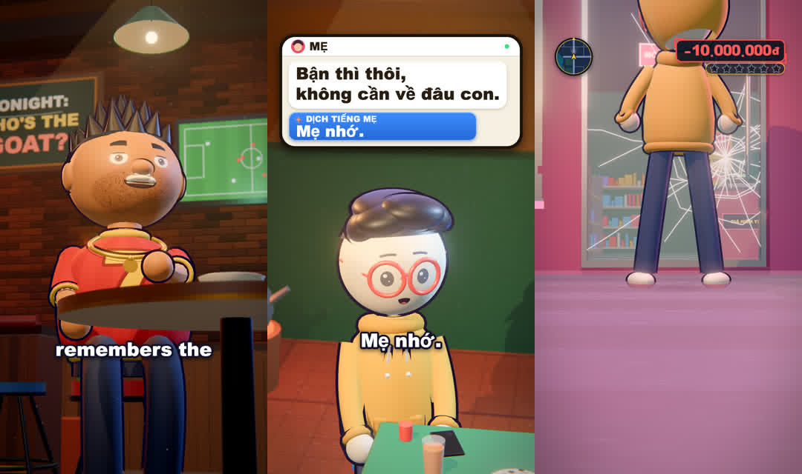

# cine3d

A small real-3-D engine for 9:16 dialogue Shorts, plus the AI-agent workflow that drives it. Characters, sets, camera, lip-sync, text overlays and sound are code; each episode is a small data file.



**Tiếng Việt:** engine 3D tự viết cho video Short dọc, kèm toàn bộ quy trình: agent, skill, cổng kiểm máy, cổng kịch bản. Mỗi tập là một file dữ liệu, máy kiểm trước khi người xem.

## What is here

| Folder | Content |
|---|---|
| `core/`, `main.js`, `index.html` | Engine: stage, rig, gait, camera, overlays, player, plus opt-in `core/ep_kit.js` authoring helper |
| `packs/` | Characters and sets of two shows: a Vietnamese tea stall (`trada`) and an English football pub (`goat`) |
| `episodes/` | Three sample episodes: `gb11`, `gta6p2`, `mekhongcanve` |
| `demo/` | Look tests for sets, props and effects |
| `tools/` | Render, QA, collision check, smoothness check, script lint, animatic, voice and mix, audio gate, pipeline, unified `build_check.py` |
| `audio_lib/` | Sound effects, ambience, music; sources in `audio_lib/LICENSES.md` |
| `blender/` | Retired Blender path, kept for reference |
| `pipeline/` | Step table and brief templates for the agents |
| `agents/`, `skills/` | Claude Code agents and skills (builder, reviewers, script writer, idea scout) |
| `.agents/`, `GEMINI.md` | **Gemini Studio**: standalone Gemini / Antigravity workflow (skills, compact channel specs, `ENGINE-CORE.md`, JSON schemas, Python `run_workflow` orchestrator) |
| `workflow/` | Production workflow, model routing, script gate, self-check, machine checks (mostly Vietnamese) |
| `ENGINE.md`, `docs/` | Engine manual and benchmark notes (`docs/gemini-studio-benchmark.md`) |

## How an episode is made

1. Card, then a one-page treatment.
2. Script and `beats.json`, checked by `tools/scriptlint.py`, then read by an independent reviewer agent.
3. Build, then a silent animatic that the owner approves. Voice credit is locked until then.
4. Voice, mix, `tools/audiogate.py`, retiming.
5. Picture checks: `tools/qa.cjs`, `tools/clipcheck.cjs`, `tools/smooth.py`.
6. Render at 30 fps, then a blind review by another agent, then the owner.

## Gemini Studio (Gemini / Antigravity Workflow)

A standalone, Gemini-native production system placed cleanly in `.agents/` and `GEMINI.md` (zero changes to `.claude/`, 100% backwards-compatible with existing Claude workflows and legacy episodes).

**Tiếng Việt:** Hệ thống sản xuất video dành riêng cho **Gemini / Antigravity** (độc lập hoàn toàn với bộ Claude cũ), tận dụng lợi thế **xem video chuyển động thật & nghe âm thanh thật trực tiếp**, điều phối kỹ thuật bằng code Python (`run_workflow` = 0 token điều phối), ép JSON Schema cứng và tách tài liệu gọn (giảm **93.8%** dung lượng tài liệu nạp vào context: `410 KB → 25.4 KB`).

### What's new in this update
- **Single 3D build on real voice timing + strict ElevenLabs credit lock:** Use `pipeline.py new <id> --channel trada|goat --workflow gemini`. `voice.py record` stays hard-locked (`exit 3`) until the owner explicitly approves spend via `credit_owner OK --quote "<owner words>"` after `script_gate` PASS + `voice.py need` quote.
- **Native multimodal review (replaces contact sheets & 8 fps motion strips):** `tools/build_check.py` outputs a compact `out/<id>/review_proxy.mp4` (`540×960`, `24 fps`, `~2–4 MB`) and `out/<id>/audio/mix_preview.mp3` (`96k`, `~550 KB`) so Gemini watches real motion and listens to voice, lip-sync, music, and SFX directly via `read_file`.
- **Zero-token Python orchestration + strict model tiering:** `.agents/workflows/episode_pipeline.py` + `.agents/workflows/schemas.py` route high-judgment tasks to **Gemini 4 Neon (High)**, blind script & 6-door video gates to **`pro`**, batched 3D building (≤ 3 rounds) to **`flash`**, and packaging to **`flash_lite`**.
- **Unified check & render CLI (`tools/build_check.py`, ≤ 25 lines stdout):** Replaces scattered calls to `lips.cjs`, `qa.cjs`, `clipcheck.cjs`, `render.cjs`, `smooth.py`, `voice.py build`, `audiogate.py`, and `scriptlint.py`, plus flags `SYNTH_FALLBACK` SFX automatically.
- **Engine & tool fixes (100% backwards-compatible):** Fixed `audio_lib/catalog.json` (`mood_map.ai`), Blueprint v2 caption right-edge safe zone (`core/overlay.js`), `qa.cjs` v2 length/hook/`overlay_v2` checks, `pipeline.py` stale step-3 cache bug, Python 3.9 f-string compatibility, `animatic.py` unused label skipping, and `regress.py --available` for clean repo clones.

### Quick start (Gemini Studio)

```bash
# 1. Start a Gemini-workflow episode (read GEMINI.md + .agents/skills/gemini-studio/SKILL.md)
python3 tools/pipeline.py new <id> --channel trada --workflow gemini

# 2. Unified audio build + gate + real-time lint + mix_preview.mp3 + SYNTH_FALLBACK check
python3 tools/build_check.py episodes/<id>.beats.json --audio

# 3. Unified picture check (auto-lips + qa.cjs + clipcheck.cjs, <= 25 lines)
python3 tools/build_check.py episodes/<id>.js

# 4. Final 30fps CRF17 render + smooth.py + review_proxy.mp4 (~2-4 MB)
python3 tools/build_check.py episodes/<id>.js --final

# 5. Regression check (owner machine / clean clone)
python3 tools/regress.py              # full reference stills
python3 tools/regress.py --available  # public repo clone
```

See [GEMINI.md](GEMINI.md), [.agents/skills/gemini-studio/SKILL.md](.agents/skills/gemini-studio/SKILL.md), and [docs/gemini-studio-benchmark.md](docs/gemini-studio-benchmark.md) for full workflow details and live benchmark measurements.

## Run it

```bash
npm install
npx playwright install chromium
node tools/render.cjs stills episodes/gb11.js out/stills 8
node tools/qa.cjs episodes/gb11.js
```

Node and ffmpeg are required; the Python tools that handle sound also need numpy and scipy. Tested on macOS with Metal; other systems were not tested.

## Not included

Recorded voices, rendered video, unreleased episodes, channel accounts and posting tools, channel statistics, API keys, original fonts (system fonts are used, so text looks different) and two music tracks of unclear origin. Voice IDs are placeholders. Some notes mention files that live outside this repo.

## Rights

No licence is granted for the code, characters and texts. Sound files and textures keep their own licences (see `audio_lib/LICENSES.md` and `packs/trada/assets/stall_plus/README.md`). Fan parody content is not affiliated with any person, club, game or company it mentions.
