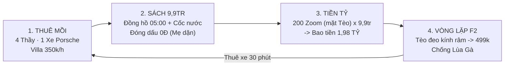

# thaylamgiau — Thầy Dạy Làm Giàu 4.0 (treatment, target 24–34 tuổi)

1. **Phản xạ Share:** Người xem 24–34 tuổi gửi cho nhóm bạn văn phòng / đồng nghiệp thân hoặc đứa bạn tối nào cũng lướt clip "Mentor 9x vest đen đứng cạnh Porsche" kèm câu *"Nhìn sơ đồ xong tỉnh ngủ luôn"*.
2. **Đòn phủ đầu (≤ 5,5 s):** Giây `2,28 s`, Tèo mặc áo vest đi mượn vừa vỗ ngực *"Tao sắp thành triệu phú!"* -> Bíp đẩy cốc trà đá 5k + sổ nợ 24 cốc chốt đúng 5 âm tiết *"Nợ trà đá xong chưa?"*.
3. **Miếng hài & Visual Gag:** Bíp lắp từng mảnh **Sơ đồ 2D "Vòng Lặp Thầy Làm Giàu"** ngay nửa trên màn hình (4 ông thầy đứng chung 1 biển số Porsche; app villa sống ảo 350k/giờ; sách 9,9tr in cỡ chữ khổng lồ *"Dậy lúc 5 giờ"* -> Bíp chốt *"Mẹ mày dặn miễn phí"*).
4. **Gieo & Gặt:** Gieo tem `XE TỰ LÁI` ở giây `0–2 s` + câu hỏi *"Thế hai tỷ thầy khoe đâu?!"* -> Gặt ở `65%` bằng mũi tên dòng tiền `9,9tr × 200 người = 1,98 tỷ` khoanh đỏ mặt Tèo trong phòng Zoom (*"Hai trăm đứa như mày."*) -> Gặt tầng 2: mũi tên đỏ vòng ngược về Bước 1 khi Tèo mở *"Khóa Chống Lùa Gà 499k"* và hỏi thuê xe nửa tiếng.

---

## About (Định vị khán giả 24–34 tuổi)
Khán giả 24–34 tuổi ở thành thị Việt Nam đã đi làm, từng nghe bạn bè hoặc quảng cáo rao bán khóa *"Tư duy triệu phú / Tự do tài chính"*, ghét bị giảng đạo nhưng cực khoái **mổ xẻ bản chất dòng tiền bằng sơ đồ trực quan + châm biếm lạnh lùng**. Tập phim không dạy đạo đức mà để Bíp vẽ thẳng **Sơ đồ 4 bước "Vòng Lặp Lùa Gà"** ngay trên nửa trên khung hình, bóc từ vốn thuê đạo cụ (4,35tr) tới doanh thu 1,98 tỷ và cú tự lặp F2 của chính Tèo.

## Feelings (Biểu đồ cảm xúc)
Sĩ diện khoe mẽ (`0–4 s`) -> bị chọc quê (`2,3 s`) -> bóc phốt từng lớp đạo cụ, cười gắt dần (`6–19 s`) -> bật dậy chất vấn (`19 s`) -> cú đấm dòng tiền đứng hình (`22–25 s`) -> tưởng tỉnh ngộ -> bật cười cay đắng khi Tèo tự đóng vòng lặp F2 (`27–34 s`).

## Sơ đồ 2D giải thích trực quan — Style "Imagine Diagram" (ít chữ, hình sinh động)
> Nguyên tắc giống `mekhongcanve` nhưng theo style **Imagine Diagram**: **Nửa trên (`x: 64..1016`, `y: 186..786`)** là bảng mây suy nghĩ nền kem ấm (`#fff9ee`) viền mực cartoon `#231a3d` kèm 3 chấm mây nổi phía trên Tèo & Bíp. **90% hình vẽ 2D sinh động có chuyển động, tối đa 1–3 chữ/nhãn** để người xem 24–34 tuổi nhìn 1 giây hiểu liền kể cả khi tắt tiếng. **Nửa dưới (`y > 820`)** giữ nguyên quán trà đá + Tèo & Bíp sắc nét (`look2 + facePlus + act2`), không làm mờ nhân vật, không cần dựng đồ 3D mới.

### Lắp ghép hình vẽ theo từng mốc giây (`episodes/thaylamgiau_props.js`)
- **Mở đầu (`0,0–2,15 s`):** Hook `THẦY GIÀU THẬT KHÔNG?` (`y: 342`) + bong bóng mơ mộng bên dưới vẽ chiếc **Porsche đỏ** lấp lánh cạnh "Thầy Mentor" kính râm + tem nhỏ `THUÊ` dán kín đáo trên kính lái *(manh mối xem lại)*.
- **Bước 1 (`6,27–14,2 s`, `p_plate` -> `p_villa`):** Ô **`1. THUÊ MỒI`** bật nảy: **4 ông thầy giống hệt nhau** bật ra quanh đúng 1 chiếc Porsche biển `30K-888` kèm tia flash máy ảnh nháy liên tục (`4 THẦY · 1 XE`); ở `11,07 s` bật thêm hình **Villa hồ bơi** + đồng hồ xoay (`350K/H`).
- **Bước 2 (`16,31–19,3 s`, `p_pdf` -> `b8`):** Mũi tên nối sang ô **`2. SÁCH 9,9TR`**: quyển sách bìa cứng mở đôi — trang trái là **đồng hồ báo thức đỏ rung `05:00`**, trang phải là **cốc nước ấm bốc khói** -> đúng câu *"Mẹ mày dặn miễn phí"*, con dấu đỏ **`0Đ · MẸ DẶN MIỄN PHÍ`** đóng phập xuống mặt sách.
- **Bước 3 (`21,43–25,1 s`, `p_dip` -> `b10` TWIST):** Mũi tên vàng bắn sang ô **`3. TIỀN TỶ ĐÂY!`**: lưới **Zoom `×200`** có vòng tròn đỏ nhấp nháy phóng to đúng mặt **Tèo đeo kính đỏ**, kèm **tờ tiền xanh bay thành thác** đổ thẳng vào **bao tiền vàng căng phồng `1,98 TỶ`** (`200 × 9,9TR = 1,98 TỶ`).
- **Bước 4 (`27,42–34,42 s`, `b12` -> `b14` PAYOFF):** Bóng đèn vàng nảy sáng -> ô **`4. VÒNG LẶP F2`** hiện **Tèo mặc vest + kính râm** (`KHÓA CHỐNG LÙA GÀ · CHỈ 499K!`) -> mũi tên đỏ nét đứt chạy chuyển động **`↺ THUÊ XE 30 PHÚT`** vòng ngược đâm thẳng về chiếc Porsche ở Bước 1!

## Cause chain (Chuỗi nhân-quả)
Tèo mặc vest đi mượn khoe mua khóa 9,9tr -> Bíp nhắc nợ trà đá 24 cốc -> Tèo khoe siêu xe của thầy -> Bíp lắp Node 1 (4 thầy chung 1 biển số thuê) -> Tèo gỡ bằng biệt thự -> Bíp bồi thêm app villa 350k/giờ -> Tèo lôi quyển "bí kíp" -> Bíp lắp Node 2 ("Dậy lúc 5 giờ — Mẹ mày dặn miễn phí") -> Tèo tức tối hỏi 2 tỷ thầy khoe ở đâu -> Bíp vẽ Node 3 (9,9tr × 200 học viên Zoom khoanh đỏ mặt Tèo: "Hai trăm đứa như mày") -> Tèo nổi máu "khởi nghiệp" mở khóa Chống Lùa Gà 499k -> Bíp đóng vòng lặp Node 4 về lại app thuê xe ("Thuê xe mấy tiếng?").

## Tension curve
`s0` 5 · `s2` 6 (phủ đầu) · `s7` 6 (4 thầy 1 xe) · `s11` 7 (villa 350k) · `s17` 4 (dip lạnh: Mẹ dặn miễn phí) · `s19` 7 (Tèo nổ tung hỏi 2 tỷ) · `s21` 5 (dip nhạc trước cú lật) · `s22–25` 9→10 (đỉnh cao trào lưới Zoom 1,98 tỷ) · `s25` 6 (giả vờ tỉnh ngộ) · `s27` 9 (payoff mở khóa 499k) · `s30–34` 6→7 (callback thuê xe, cắt sắc).

## 0–3 s
Cận mặt Tèo mặc vest rộng đi mượn giơ ảnh thầy cạnh Porsche (`XE TỰ LÁI` ở góc kính); hook `THẦY GIÀU THẬT KHÔNG?` tắt ở `2,1 s`; thoại `b1` *"Tao sắp thành triệu phú!"* (5 từ, 0 trùng hook); `2,28 s` Bíp đẩy cốc trà đá + sổ nợ chốt *"Nợ trà đá xong chưa?"*.

## 4–10 s
Tèo khinh khỉnh khoe xe thầy -> `p_plate` (`6,27 s`) bật **Node 1 Sơ đồ**: 4 ông thầy chung 1 biển số -> Bíp *"Bốn thầy chung con xe."* -> Tèo vội chuyển sang khoe biệt thự.

## Last 15 s
Sau khi Bíp hạ gục cuốn sách (*"Mẹ mày dặn miễn phí"*), Tèo đập bàn hỏi *"Thế hai tỷ thầy khoe đâu?!"*. Nhạc dip xuống (`p_dip`), **Node 3 Sơ đồ** nổ ra công thức `9,9tr × 200 người = 1,98 tỷ` kèm vòng đỏ khoanh mặt Tèo trên Zoom -> Bíp thì thầm *"Hai trăm đứa như mày."* Im `0,9 s` đỉnh cao trào. Tèo giả vờ phẫn nộ *"Cay thật! Bọn lùa gà!"* rồi xoay 180 độ *"Tao mở khóa… chống lùa gà!"* -> **Node 4** vẽ mũi tên đỏ khóa vòng lặp quay lại Node 1 -> Bíp *"Thuê xe mấy tiếng?"* -> Tèo *"Nửa tiếng chụp ảnh thôi!"* -> cắt sắc `tail 0,6 s`.

## Sound plan
Nhạc nền hài châm biếm gọn nhịp (`comedy_playful` / bass nhẹ); `pop` / `shutter` khi ghép từng ô sơ đồ Node 1; `ting` khi bật giá villa; `thud` khi Tèo đập sách và đập bàn; `paper_slip` khi lật sách; ở `p_dip` (`21,4 s`) nhạc hạ hẳn chỉ còn `tick` -> `boom` + `kaching` nhẹ khi hiện `1,98 tỷ`; `ding_idea` khi mắt Tèo lóe sáng mở khóa 499k; `msg_in` lúc gõ bài bán khóa; cắt khô sạch sau `b14`. Không nhạc chèn lời.
